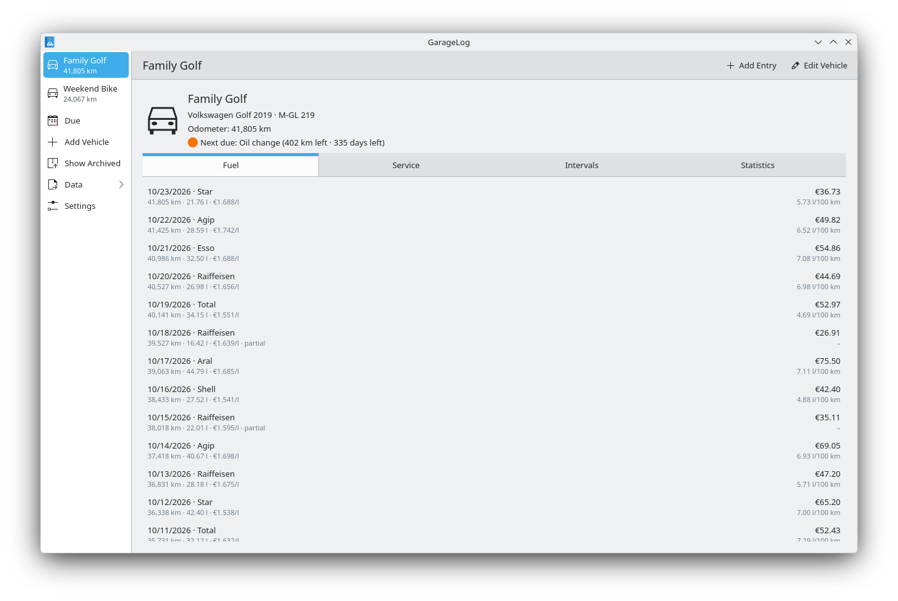
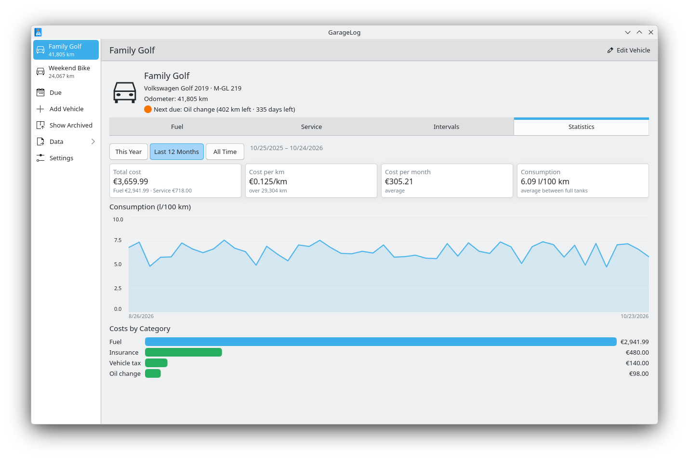
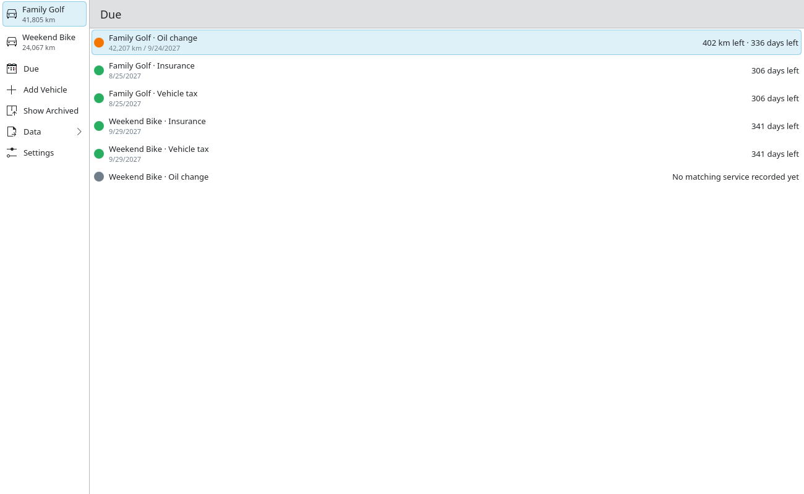

# GarageLog

A private logbook for your cars, motorcycles, scooters and electric vehicles: fuel and charging, service history, maintenance intervals and costs.
Native Linux desktop app built with Qt 6 and Kirigami. Local and offline – no account, no cloud, no telemetry. Your data is one SQLite file you own.



| Statistics | Due maintenance |
|---|---|
|  |  |

## Features
- **Fuel and charging log** – consumption between two full tanks, partial fills, l/100 km, kWh/100 km or mpg
- **Service history** – categories, workshop or do-it-yourself, attached receipts (PDF, images)
- **Maintenance intervals** – by distance, by time or both; one list of everything that is due across all vehicles
- **Statistics** – total cost, cost per kilometre and per month, consumption chart, costs by category
- **Import and export** – full JSON export/import, CSV export of all tables, CSV import of fuel entries (e.g. from other apps)
- **Units** – kilometres or miles, litres, US or imperial gallons, any currency symbol
- **Several garages** – each garage is one file plus an `attachments` folder; open, create or copy garages from the settings
- English and German user interface

## Install
**Flatpak** (Flathub submission in preparation): until then, build the Flatpak locally – see [CONTRIBUTING.md](CONTRIBUTING.md#building-and-testing).

**From source** (Arch/CachyOS):
```
sudo pacman -S --needed base-devel cmake extra-cmake-modules qt6-base qt6-declarative \
    kirigami ki18n kcoreaddons kconfig kquickcharts
cmake -B build -DCMAKE_BUILD_TYPE=Release
cmake --build build
sudo cmake --install build
```

## Your data
- The default garage lives in `~/.local/share/garagelog/garage.sqlite` (Flatpak: `~/.var/app/io.github.TSTS87.GarageLog/data/garagelog/`).
- Attachments are copied into an `attachments` folder next to the garage file. To back up, copy both – or use *Data → Export Everything*.
- GarageLog never connects to the network.

## Contributing
Bug reports, translations and pull requests are welcome – see [CONTRIBUTING.md](CONTRIBUTING.md).
Design notes: [specification](docs/SPEC.md), [data model](docs/DATA_MODEL.md), [decisions](docs/DECISIONS.md).

## Support
GarageLog is free and stays free. If it saves you time or money, you can support its development via [GitHub Sponsors](https://github.com/sponsors/TSTS87).

## License
GarageLog is free software under the [GNU General Public License v3.0 or later](LICENSE).
